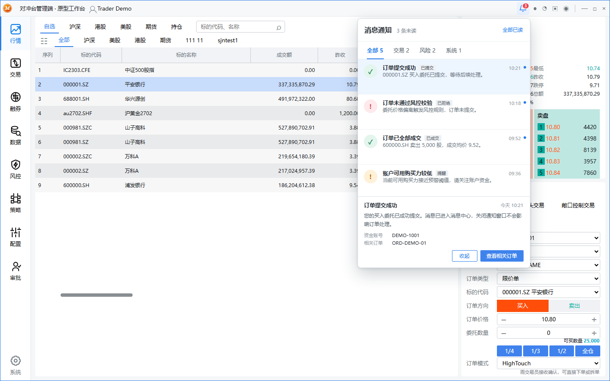

# Trader Workspace Prototype

根据桌面 Trader 端截图复刻的高保真交互原型，用于后续需求设计、交互讨论和分支迭代。

## 当前覆盖

- 行情：自选列表、五档行情、下单面板、买卖方向、价格/数量步进、仓位快捷选择。
- 交易：普通/空头/敞口/套利下单字段切换、二次确认、无需审批、手工单，以及 HighTouch“确认→直接下单/拆单→子单与成交联动”。
- 融券：召回撮合概览、委托区、撮合敞口池。
- 数据：资金管理、持仓信息、汇率管理、保证金比例、成交查询、对冲持仓、交易日、订单查询八个可切换子页面，包含查询、导出、日期快捷筛选及汇总维度演示。
- 风控：交易事前、交易事中、资管事前规则分类，规则启停/删除/导出、真实字段结构的新增规则弹窗和风控消息演示。
- 配置：购买力账号、订单模式与柜台账号映射；展示默认渠道和智能路由的关系。
- 审批：QFII资管待审批/已审批事项、审批明细、审批通过与拒绝。
- 消息通知：右上角铃铛入口、未读数量、订单/市场/风控/系统一级分类；母单、子单、全部拒单和沪深、港股、美股二级筛选；拒单环节与原因、休市与恢复时间详情，以及全部已读和相关订单跳转。

策略、系统入口暂保留为待补充模块。页面数据均为演示数据，不连接真实交易系统，也不会实际报单。休市日期为原型演示信息，生产实现应接入经确认的市场日历来源。

## 消息通知预览



补充依据来自“机构用户手册”历史聊天沉淀的机构交易、HighTouch、订单补录、数据查询、配置与风控章节。原型只实现有页面截图、用户纠正或手册字段明确支撑的内容；未确认模块继续保留占位提示。

## 本地运行

该原型没有构建依赖，直接用静态服务器启动即可：

```powershell
python -m http.server 4173
```

然后访问 `http://127.0.0.1:4173`。

## 迭代建议

后续需求从当前基线创建 `codex/<topic>` 分支，原型变更与需求说明一同提交。涉及真实业务规则时，以用户手册、当前系统配置和产品确认结果为准，不从演示交互反推生产逻辑。
